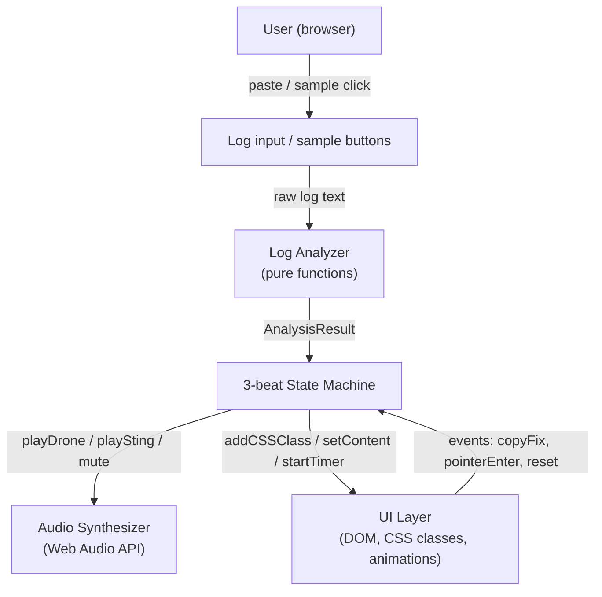
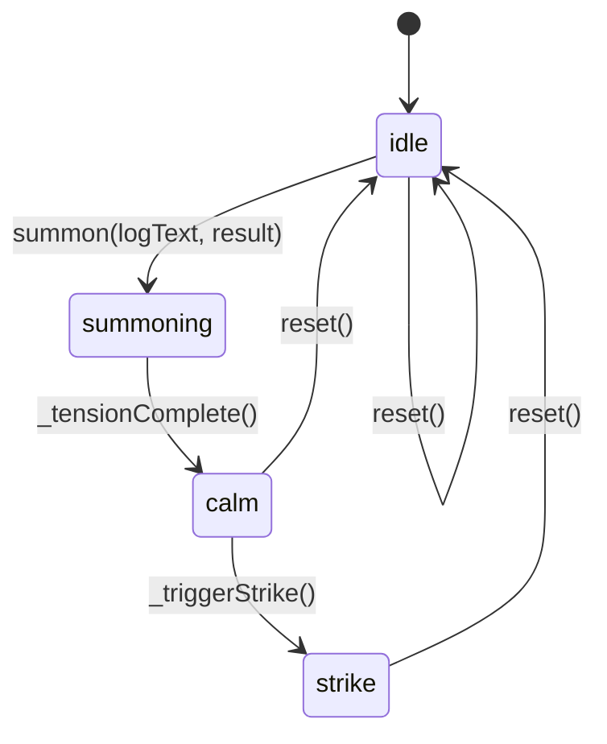

# Design Document

## Overview

Séance is a single-page, static web app that transforms developer error-log triage into a Victorian spirit-board horror experience. The core interaction is a 3-beat false-suspense loop: a tense animated analysis, a calm and seemingly harmless surface finding, then a delayed shock that surfaces a genuinely dangerous hidden issue. All logic runs client-side in vanilla HTML/CSS/JS; no build step, no dependencies, no server.

The design is organized around four concerns that must stay cleanly separated:

1. **Analysis** — pure functions that classify a log and extract findings.
2. **Audio** — a synthesizer that generates a rising drone and a sharp sting via the Web Audio API.
3. **State machine** — drives the app through its four phases: `idle → summoning → calm → strike` (or `calm → reset` when no critical pattern exists).
4. **UI** — the DOM, animations, and event handlers that the state machine controls.

---

## Architecture

The app is a flat, three-file static site. All code lives in `app.js`, divided into five clearly commented sections that mirror the structure described in the steering document.



The `Analyzer` never touches the DOM. The `AudioSynth` never reads the DOM. The `StateMachine` is the only module that coordinates all three. Event handlers in the UI layer call state machine transition functions and do nothing else.

---

## Components and Interfaces

### 1 — Log Analyzer

Located in `app.js` under `// --- ANALYZER ---`.

#### `analyzeSurface(logText: string): SurfaceFinding`

Scans the log for a minor, harmless issue to present as the initial result. Priority order:

| Check | Pattern | Label |
|---|---|---|
| Undefined variable | `/ReferenceError/i` | Undefined variable reference |
| Null dereference | `/Cannot read propert/i` | Null dereference |
| Uncaught exception | `/Uncaught/i` | Uncaught exception |
| Stack overflow | `/Maximum call stack/i` | Stack overflow |
| Network timeout | `/timeout|ETIMEDOUT/i` | Network timeout |
| Generic fallback | (always) | Unexpected runtime error |

Returns the first match, or the fallback if none match.

#### `analyzeHidden(logText: string): HiddenFinding | null`

Scans for critical patterns. Returns the first match found, or `null`.

| Pattern | Type | Remediation summary |
|---|---|---|
| `/[A-Za-z0-9_]{20,}.*[Kk]ey\|[Tt]oken\|[Ss]ecret/` | Exposed credential | Rotate immediately, move to env vars |
| `/password\s*=/i` | Hardcoded password | Use secrets manager |
| `/eval\s*\(/` | Unsafe eval | Replace with safe alternative |
| `/DROP\s+TABLE/i` | SQL injection vector | Parameterize queries |
| `/CRITICAL\|FATAL/i` | Critical/fatal frame | Investigate stack frame immediately |

The patterns are tested in this priority order; the first match wins.

#### `buildSuggestedFix(finding: SurfaceFinding): string`

Returns a human-readable, one-sentence fix string for the surface finding. Pure function.

---

### 2 — Audio Synthesizer

Located in `app.js` under `// --- AUDIO ---`.

The `AudioContext` is created lazily on the first user click and stored in a module-level variable. All subsequent calls reuse it. A single master `GainNode` sits at the end of every audio graph; the mute toggle sets `masterGain.gain.value` to `0` or `1`.

#### `initAudio(): void`

Creates `AudioContext` and `masterGain` if not already created. Connects `masterGain` to `context.destination`. Safe to call multiple times.

#### `playDrone(durationSeconds: number): DroneHandle`

Builds a rising sub-bass tension drone:

- Two `OscillatorNode`s: one `sine` at ~40 Hz, one `sawtooth` at ~60 Hz.
- Both feed a `BiquadFilterNode` (lowpass, cutoff ~200 Hz, Q 5) for a muffled rumble.
- A `GainNode` with a linear ramp from 0 → 0.6 over `durationSeconds`.
- Returns a `DroneHandle` with a `stop()` method that ramps gain to 0.0001 over 0.3 s then disconnects.

#### `playSting(): void`

Plays the sharp discordant sting:

- Three `OscillatorNode`s at dissonant intervals: ~440 Hz (`sawtooth`), ~466 Hz (`sawtooth`), ~523 Hz (`square`).
- Fed into a `WaveShaperNode` with a hard-clip distortion curve.
- A `GainNode` with an attack of 5 ms and exponential decay to 0.0001 over 0.4 s.
- Oscillators auto-stop after 0.5 s.

#### `stopAll(): void`

Calls `stop()` on any live `DroneHandle` and disconnects nodes. Used on reset.

---

### 3 — State Machine

Located in `app.js` under `// --- STATE MACHINE ---`.



State is a plain object:

```js
let state = {
  phase: 'idle',          // 'idle' | 'summoning' | 'calm' | 'strike'
  result: null,           // AnalysisResult | null
  droneHandle: null,      // DroneHandle | null
  strikeArmed: false,     // true when hidden finding exists and strike hasn't fired
  strikeTimer: null,      // setTimeout handle
  strikeFired: false,     // guards the "fire at most once" rule
};
```

#### Transitions

| Function | From | To | Description |
|---|---|---|---|
| `summon(logText)` | `idle` | `summoning` | Runs analyzer, dims screen, starts drone, starts planchette walk, schedules `_tensionComplete` after ~3 s |
| `_tensionComplete()` | `summoning` | `calm` | Stops drone ramp, switches to parchment mode, displays surface finding |
| `copyFix()` | `calm` | `calm` | Copies fix text; if `strikeArmed`, starts 4 s timer calling `_triggerStrike` |
| `pointerNearInput()` | `calm` | `calm` | If `strikeArmed && !strikeFired`, calls `_triggerStrike` immediately |
| `_triggerStrike()` | `calm` | `strike` | Guards via `strikeFired`; fires flash, sting, planchette slam, reveals hidden finding |
| `reset()` | any | `idle` | Clears all timers, stops all audio, restores dark theme |

---

### 4 — UI Layer

Located in `app.js` under `// --- UI ---`.

The UI layer is entirely reactive to state machine calls. It has no internal state. Each state machine transition calls a small set of UI functions:

| UI function | What it does |
|---|---|
| `setPhase(phase)` | Adds/removes `data-phase` attribute on `<body>` for CSS targeting |
| `setPlanchetteZone(zone)` | Updates planchette `transform: translate(x, y)` to the named zone |
| `showSurfaceFinding(finding, fix)` | Populates result panel with surface text |
| `showHiddenFinding(finding)` | Populates result panel with hidden issue and remediation |
| `triggerFlash()` | Adds `.invert-flash` class, removes it after 250 ms |
| `showCopyConfirmation()` | Briefly shows "Copied!" feedback |
| `fillTextarea(sampleText)` | Loads a sample log into the textarea |

The spirit board itself is static HTML. The five zone positions are encoded as a constant map:

```js
const ZONE_POSITIONS = {
  syntax:   { x: '15%', y: '30%' },
  network:  { x: '35%', y: '55%' },
  auth:     { x: '55%', y: '30%' },
  memory:   { x: '75%', y: '55%' },
  critical: { x: '45%', y: '75%' },
};
```

---

## Data Models

### `SurfaceFinding`

```js
{
  type: string,       // e.g. 'ReferenceError', 'NetworkTimeout', 'Generic'
  label: string,      // human-readable label shown in the UI
  matchedText: string // first matching line or '' for the fallback
}
```

### `HiddenFinding`

```js
{
  type: string,         // e.g. 'ExposedCredential', 'HardcodedPassword'
  matchedText: string,  // the matched substring (truncated to 80 chars)
  severity: 'CRITICAL', // always CRITICAL for now
  remediation: string   // one-sentence remediation
}
```

### `AnalysisResult`

```js
{
  surface: SurfaceFinding,
  hidden: HiddenFinding | null
}
```

### `DroneHandle`

```js
{
  stop: () => void   // ramps gain to near-zero then disconnects nodes
}
```

---

## Correctness Properties

*A property is a characteristic or behavior that should hold true across all valid executions of a system — essentially, a formal statement about what the system should do. Properties serve as the bridge between human-readable specifications and machine-verifiable correctness guarantees.*

### Property 1: Surface finding is always present

*For any* non-empty log string, `analyzeSurface` SHALL return a `SurfaceFinding` with a non-empty `label` and a non-empty `type`.

**Validates: Requirements 3.1, 3.4**

### Property 2: Hidden scan returns null for safe logs

*For any* string that contains none of the critical patterns (exposed credential token, `password=`, `eval(`, `DROP TABLE`, `CRITICAL`, `FATAL`), `analyzeHidden` SHALL return `null`.

**Validates: Requirements 3.2, 7.6**

### Property 3: Hidden scan detects all critical patterns

*For any* log string that contains at least one critical pattern substring, `analyzeHidden` SHALL return a non-null `HiddenFinding` whose `type` identifies the matched category.

**Validates: Requirements 3.2, 3.3**

### Property 4: Strike fires at most once per analysis run

*For any* sequence of `copyFix()` calls and `pointerNearInput()` events after a single `summon()`, the strike transition SHALL execute at most once (i.e., `strikeFired` becomes `true` on first fire and gates all subsequent calls).

**Validates: Requirements 7.5**

### Property 5: Strike never fires when no hidden pattern exists

*For any* log whose `analyzeHidden` result is `null`, no sequence of UI events SHALL cause the strike transition to execute.

**Validates: Requirements 7.6**

### Property 6: Whitespace-only input is rejected

*For any* string composed entirely of whitespace characters (spaces, tabs, newlines), clicking "Summon Diagnosis" SHALL show an in-theme rejection message and SHALL NOT transition the state machine out of `idle`.

**Validates: Requirements 1.3**

### Property 7: Reset returns to idle from any phase

*For any* state machine phase (`idle`, `summoning`, `calm`, `strike`), calling `reset()` SHALL transition to `idle`, clear `strikeFired`, clear `strikeTimer`, and stop all audio.

**Validates: Requirements 9.1, 9.2**

---

## Error Handling

### Web Audio API unavailable

If `window.AudioContext` and `window.webkitAudioContext` are both absent, `initAudio()` sets a module flag `audioDisabled = true`. All subsequent audio calls are no-ops. The visual experience continues unaffected.

### Clipboard API unavailable

`copyFix()` calls `navigator.clipboard.writeText()` inside a try/catch. On failure it falls back to `document.execCommand('copy')` after selecting the fix text. If that also fails, the fix text is selected visually so the user can copy manually with Ctrl+C.

### Empty or whitespace input

Before calling `analyzeSurface`, `summon()` trims the input. If the result is empty, it calls `showEmptyInputMessage()` (a UI function that displays a themed "The spirits find no message here…" notice) and returns without changing phase.

### Sample log loading failure

Sample logs are inline JS strings — no fetch, no network call. This error path cannot occur.

### Regex exceptions

All regex patterns in the analyzer are literals compiled at load time. They cannot throw at runtime. Each pattern is wrapped in a try/catch as a belt-and-suspenders measure; a pattern failure degrades gracefully to `null` for that check.

---

## Testing Strategy

### Approach

The analyzer functions are pure and have no DOM or audio dependencies, making them the natural target for automated testing. The state machine transitions are logic-only functions and are equally testable. The UI layer and audio synthesizer are side-effect-only and are tested manually.

Property-based testing is appropriate for the analyzer and state machine because:

- Input variation is meaningful (any log string can trigger different branches).
- Running 100+ iterations finds edge cases around regex boundaries and whitespace handling that example-based tests miss.
- The functions are pure, so there is no cost per iteration.

The property-based testing library for this project is **[fast-check](https://fast-check.dev/)**, loaded from a CDN in the test HTML file (the production app itself has no CDN dependencies).

### Unit tests

Cover specific examples and integration points:

- Each critical pattern triggers the correct `HiddenFinding.type` (one test per pattern).
- The fallback surface finding fires when no pattern matches.
- `buildSuggestedFix` returns a non-empty string for every `SurfaceFinding.type` value.
- `reset()` from each of the four phases leaves state in the expected shape.

### Property-based tests

Each test runs a minimum of 100 iterations. Each is tagged with its design property.

| Test | Property tag | Covers |
|---|---|---|
| `analyzeSurface` always returns a non-empty label | `Feature: seance-spirit-board, Property 1: Surface finding is always present` | Req 3.1, 3.4 |
| `analyzeHidden` returns null for safe strings | `Feature: seance-spirit-board, Property 2: Hidden scan returns null for safe logs` | Req 3.2, 7.6 |
| `analyzeHidden` detects injected critical patterns | `Feature: seance-spirit-board, Property 3: Hidden scan detects all critical patterns` | Req 3.2, 3.3 |
| Strike fires at most once regardless of event count | `Feature: seance-spirit-board, Property 4: Strike fires at most once per analysis run` | Req 7.5 |
| Strike never fires when hidden is null | `Feature: seance-spirit-board, Property 5: Strike never fires when no hidden pattern exists` | Req 7.6 |
| Whitespace input stays in idle | `Feature: seance-spirit-board, Property 6: Whitespace-only input is rejected` | Req 1.3 |
| Reset from any phase lands in idle | `Feature: seance-spirit-board, Property 7: Reset returns to idle from any phase` | Req 9.1, 9.2 |

### Manual / visual checks

- Victorian theme and parchment mode render correctly on Chrome, Firefox, Safari, Edge.
- Planchette animation is smooth and lands on the correct zones.
- 250 ms inversion flash is visible but not seizure-inducing.
- Drone rises and sting fires cleanly with no clicks or pops.
- Mute toggle silences all sound immediately.
- Layout is usable on a 1280 × 800 laptop viewport.
- All three sample logs produce the correct experience paths (two with strike, one without).
