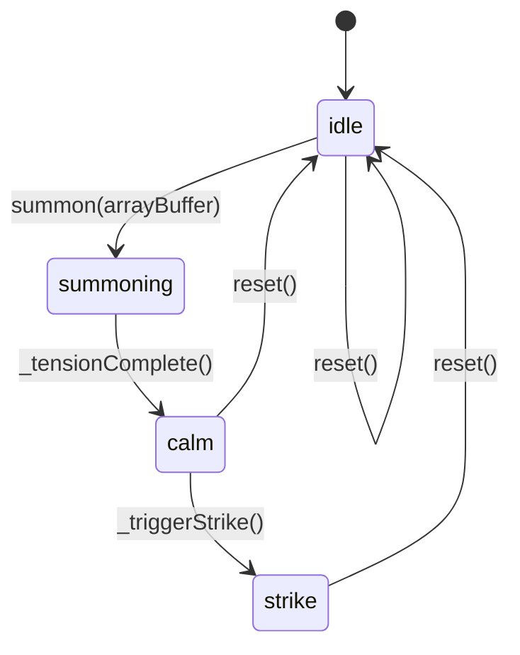

# Design Document

## Overview

Packet Séance is a single-page, static web app that transforms a `.pcap` network capture into a Victorian ghost-story experience. The core interaction is a 3-beat false-suspense loop: a tense animated analysis where the planchette stalks across a spirit board, a calm and apparently harmless traffic summary, then a delayed shock that reveals hidden suspicious activity. All logic runs client-side in vanilla HTML/CSS/JS; no build step, no dependencies, no server.

The design is organized around four concerns that stay cleanly separated:

1. **Parsing** — pure functions that read pcap bytes and decode packet fields.
2. **Detection** — pure functions that classify decoded packets and return structured findings.
3. **Narration** — pure template functions that turn findings into ghost-story text.
4. **Orchestration** — the state machine, audio synthesizer, and UI wiring in `app.js`.

Each concern lives in its own file. Files expose plain global functions only; there are no ES module imports so the app works when opened directly from a file system.

---

## Architecture

Eight files are loaded in order via plain `<script>` tags. No bundler, no npm.

```mermaid
flowchart TD
    User["User (browser)"]
    FileInput["File input / drag-drop / sample buttons"]
    Pcap["pcap.js\n(parsePcap, decodePacket, buildSummary)"]
    Detectors["detectors.js\n(runDetectors, 5 pure detector functions)"]
    Story["story.js\n(generateSummaryStory, generateFindingStory,\ngeneratePeacefulStory)"]
    StateMachine["app.js — State Machine\nidle → summoning → calm → strike"]
    Audio["audio.js\n(playDrone, playSting, stopAll)"]
    UI["app.js — UI Layer\n(DOM, CSS classes, animations)"]

    User -->|upload .pcap / sample click| FileInput
    FileInput -->|ArrayBuffer| Pcap
    Pcap -->|packets[]| Detectors
    Pcap -->|packets[]| Story
    Detectors -->|findings[]| Story
    Story -->|strings| UI
    Pcap -->|summary| StateMachine
    Detectors -->|findings| StateMachine
    StateMachine -->|playDrone / playSting / stopAll| Audio
    StateMachine -->|setPhase / setPlanchetteZone / showFindings| UI
    UI -->|copySummary / pointerNearInput / reset| StateMachine
```

`pcap.js`, `detectors.js`, and `story.js` are pure-function modules: they take data in and return data out with no DOM or audio side effects. `audio.js` manages audio nodes only. `app.js` is the only module that coordinates all concerns and touches the DOM.

---

## Components and Interfaces

### 1 — `pcap.js` — Packet Parser

All functions are pure and have no DOM access.

#### `parsePcap(arrayBuffer)`

Reads the global pcap file header to detect byte order and timestamp resolution, then iterates packet records.

| Magic number | Byte order | Timestamps |
|---|---|---|
| `0xa1b2c3d4` | little-endian | microseconds |
| `0xd4c3b2a1` | big-endian | microseconds |
| `0xa1b23c4d` | little-endian | nanoseconds |
| `0x4d3cb2a1` | big-endian | nanoseconds |

- If the first four bytes are `0x0a 0x0d 0x0d 0x0a` (pcapng), throws `{ type: 'PCAPNG' }`.
- If the magic is unrecognised, throws `{ type: 'INVALID' }`.
- Stops reading after 50,000 packets; sets `truncated: true`.
- Skips any packet whose stated `inclLen` would read past the buffer end, incrementing `skipped`; never throws on bad data.

Returns:
```js
{
  packets: DecodedPacket[],
  skipped: number,
  truncated: boolean,
  linkType: number
}
```

#### `decodePacket(rawBytes, linkType, tsSeconds, tsNanoseconds)`

Decodes one raw packet buffer. Only link type 1 (Ethernet) is analyzed; other link types increment an internal counter but return a minimal object with `protocol: 'unknown'`.

Decode chain:
- **Ethernet** (14 bytes): src/dst MAC, EtherType
  - EtherType `0x0806` → ARP
  - EtherType `0x0800` → IPv4
  - Other EtherTypes → counted, not analyzed
- **ARP**: op code, sender/target IP and MAC
- **IPv4** (minimum 20 bytes): src/dst IP, protocol, TTL, total length; options skipped
  - Protocol `1` → ICMP
  - Protocol `6` → TCP
  - Protocol `17` → UDP
- **TCP**: src/dst port, flags (SYN, ACK, RST, FIN), payload bytes
- **UDP**: src/dst port, payload bytes; if dst or src port is 53 → DNS
- **ICMP**: type and code (type 8 = echo request, type 0 = echo reply)
- **DNS** (UDP port 53): question section (name, qtype, qclass), answer RCODE

Returns:
```js
{
  ts: number,         // Unix timestamp in seconds (float)
  eth: { src, dst, etherType } | null,
  arp: { op, senderIp, senderMac, targetIp, targetMac } | null,
  ip:  { src, dst, protocol, ttl } | null,
  tcp: { srcPort, dstPort, flags, payload: Uint8Array } | null,
  udp: { srcPort, dstPort, payload: Uint8Array } | null,
  icmp:{ type, code } | null,
  dns: { name, qtype, rcode } | null,
  raw: Uint8Array,
  protocol: string    // 'arp'|'ipv4'|'tcp'|'udp'|'icmp'|'dns'|'unknown'
}
```

Fields are `null` when not present in the packet.

#### `buildSummary(packets)`

Aggregates decoded packets into a surface summary.

Returns:
```js
{
  totalPackets: number,
  skipped: number,
  truncated: boolean,
  durationSeconds: number,       // ts of last packet minus ts of first
  protocolCounts: {              // keyed by protocol string
    arp: number, ipv4: number, tcp: number,
    udp: number, icmp: number, dns: number, unknown: number
  },
  topTalkers: [{ ip: string, count: number }]  // top 5 by packet count
}
```

---

### 2 — `detectors.js` — Detection Rules

All functions are pure and have no DOM access.

#### Config object

```js
const THRESHOLDS = {
  portScanMinPorts: 15,
  portScanMaxHandshakeRatio: 0.1,
  pingSweepMinHosts: 10,
  dnsNxdomainBurst: 10,
  dnsLongNameLength: 40,
  dnsHighEntropy: 3.5,      // bits per character Shannon entropy
  arpSpoofMinMacs: 2,
};
```

All five detectors read only from `THRESHOLDS`, never from magic numbers scattered through code.

#### `detectPortScan(packets)` → `Finding | null`

Groups TCP SYN packets (`flags.SYN && !flags.ACK`) by `src → dst` pair. For each pair, counts distinct destination ports and total completed handshakes (SYN+ACK seen). Returns a finding if any pair has distinct ports ≥ `portScanMinPorts` and handshake ratio ≤ `portScanMaxHandshakeRatio`. Severity: **high**.

#### `detectPingSweep(packets)` → `Finding | null`

Groups ICMP echo request packets (type 8) by source IP. Returns a finding if any source has sent echo requests to ≥ `pingSweepMinHosts` distinct destination IPs. Severity: **medium**.

#### `detectSuspiciousDns(packets)` → `Finding | null`

Inspects DNS query names. Returns a finding if any name is longer than `dnsLongNameLength` characters, has Shannon entropy above `dnsHighEntropy` bits per character, or if any single client IP receives ≥ `dnsNxdomainBurst` NXDOMAIN replies (rcode 3) across the session. Severity: **high**.

Shannon entropy formula: H = −Σ(pᵢ · log₂ pᵢ) where pᵢ is the frequency of character i in the domain name.

#### `detectCleartextCredentials(packets)` → `Finding | null`

Scans TCP payload bytes (decoded as UTF-8 where safe) for:
- HTTP `Authorization: Basic ` header (Base64 credential)
- HTTP form body containing `password=` (case-insensitive)
- FTP `USER ` or `PASS ` commands

Credentials are always masked: the first four characters are shown followed by `****`. The raw credential is never stored or returned. Severity: **high**.

#### `detectArpSpoofing(packets)` → `Finding | null`

Builds a map of `ip → Set<mac>` from ARP reply packets. Returns a finding if any IP appears with ≥ `arpSpoofMinMacs` distinct MACs. Severity: **high**.

#### `runDetectors(packets)` → `Finding[]`

Calls all five detectors and returns the array of non-null results.

#### Finding shape

```js
{
  type: 'PortScan' | 'PingSweep' | 'SuspiciousDns' | 'CleartextCredentials' | 'ArpSpoofing',
  severity: 'high' | 'medium',
  hosts: string[],     // IPs or MACs involved
  evidence: string,    // short plain-text summary; credentials masked
  packetCount: number
}
```

---

### 3 — `story.js` — Narrative Templates

All functions are pure; text is returned as strings and inserted into the DOM using `textContent`, never `innerHTML`.

#### `generateSummaryStory(summary)` → `string`

Returns a short, harmless ghost-story paragraph framing the traffic summary. References real protocol counts and packet totals from the `summary` object. Always returns a non-empty string.

#### `generateFindingStory(finding)` → `{ story, explanation, tip }`

Template-driven narration for each finding type. The `story` names real hosts and ports from `finding.hosts`. All three fields are always non-empty strings.

| Finding type | Story theme | Tip focus |
|---|---|---|
| `PortScan` | Footsteps testing every door | Block unused ports, alert on SYN floods |
| `PingSweep` | Lantern sweeping the grounds | Restrict ICMP, segment the network |
| `SuspiciousDns` | Whispered names in an unknown tongue | Monitor DNS, block C2 candidates |
| `CleartextCredentials` | A letter opened in plain sight | Use TLS, replace HTTP Basic auth |
| `ArpSpoofing` | An impostor wearing another's face | Enable dynamic ARP inspection |

#### `generatePeacefulStory(summary)` → `string`

Returns a short, peaceful story for a clean capture with no findings. Always returns a non-empty string.

---

### 4 — `samples.js` — Synthetic Capture Generators

Each function builds a minimal valid classic pcap as an `ArrayBuffer` using `DataView` with little-endian byte order and magic `0xa1b2c3d4`.

The file header format: magic (4), version major (2), version minor (2), thiszone (4), sigfigs (4), snaplen (4), network/linkType (4). Per-packet header: ts_sec (4), ts_usec (4), incl_len (4), orig_len (4), then raw bytes.

#### `generateQuietHouseCapture()` → `ArrayBuffer`

Builds ARP + DNS + HTTP packets with no suspicious patterns. Used for the "no-strike" experience path.

#### `generateKnockingVisitorCapture()` → `ArrayBuffer`

Builds TCP SYN packets to 20 distinct destination ports (one source, one destination host) and ICMP echo requests to 12 distinct hosts. Triggers `PortScan` (high) and `PingSweep` (medium).

#### `generateWhisperingWireCapture()` → `ArrayBuffer`

Builds suspicious DNS queries (names > 40 chars with high entropy, 12 NXDOMAIN replies), an HTTP request with an `Authorization: Basic` header, and ARP replies claiming one IP from two different MACs. Triggers `SuspiciousDns` (high), `CleartextCredentials` (high), and `ArpSpoofing` (high).

---

### 5 — `audio.js` — Procedural Audio Synthesizer

The `AudioContext` is created lazily on the first user click and reused thereafter. A single master `GainNode` sits at the end of every audio graph; the mute toggle sets `masterGain.gain.value` to `0` or `1` immediately.

#### `initAudio()` → `void`

Creates `AudioContext` (or `webkitAudioContext`) and `masterGain` if not already present; connects `masterGain` to `context.destination`. Safe to call multiple times.

#### `playDrone(durationSeconds)` → `DroneHandle`

Rising sub-bass tension drone:
- Two `OscillatorNode`s: `sine` at ~40 Hz and `sawtooth` at ~60 Hz.
- Both feed a `BiquadFilterNode` (lowpass, cutoff ~200 Hz, Q 5) for a muffled rumble.
- A `GainNode` with a linear ramp from `0 → 0.6` over `durationSeconds`.
- Returns `{ stop() }`: `stop()` ramps gain to 0.0001 over 0.3 s then disconnects nodes.

#### `playSting()` → `void`

Sharp discordant sting:
- Three `OscillatorNode`s at dissonant intervals: ~440 Hz (`sawtooth`), ~466 Hz (`sawtooth`), ~523 Hz (`square`).
- Fed into a `WaveShaperNode` with a hard-clip distortion curve.
- A `GainNode` with 5 ms attack and exponential decay to 0.0001 over 0.4 s.
- Oscillators auto-stop after 0.5 s.

#### `stopAll()` → `void`

Calls `stop()` on any live `DroneHandle` and disconnects all nodes. Used on reset.

#### `setMute(muted)` → `void`

Sets `masterGain.gain.value` to `0` (muted) or `1` (unmuted). No-op if audio is disabled.

---

### 6 — `app.js` — State Machine and UI Wiring

#### State machine



State object:

```js
let state = {
  phase: 'idle',          // 'idle' | 'summoning' | 'calm' | 'strike'
  packets: null,          // DecodedPacket[] | null
  summary: null,          // BuildSummary result | null
  findings: [],           // Finding[]
  droneHandle: null,      // DroneHandle | null
  strikeArmed: false,     // true when ≥1 high-severity finding exists
  strikeTimer: null,      // setTimeout handle | null
  strikeFired: false,     // guards the "fire at most once" rule
};
```

#### Transitions

| Function | From | To | Description |
|---|---|---|---|
| `summon(arrayBuffer)` | `idle` | `summoning` | Parses pcap, runs detectors, arms strike if any high-severity finding; dims screen, starts drone, starts planchette walk, schedules `_tensionComplete` after ~3 s |
| `_tensionComplete()` | `summoning` | `calm` | Stops drone ramp, switches to parchment mode, displays traffic summary |
| `copySummary()` | `calm` | `calm` | Copies summary text; if `strikeArmed`, starts 4 s timer calling `_triggerStrike` |
| `pointerNearInput()` | `calm` | `calm` | If `strikeArmed && !strikeFired`, calls `_triggerStrike` immediately |
| `_triggerStrike()` | `calm` | `strike` | Guards via `strikeFired`; fires flash, sting, planchette slam, reveals all findings |
| `reset()` | any | `idle` | Clears all timers, stops all audio, restores dark séance theme, clears results, resets `strikeFired` |

Non-transition handlers (stay in `idle`):
- `showEmptyInputMessage()` — no file loaded when "Summon Diagnosis" is clicked.
- `showPcapngMessage()` — file is pcapng; shows how to save as classic pcap.
- `showErrorMessage(msg)` — file too large (>5 MB), invalid magic, or other read error.

#### UI functions

| Function | Effect |
|---|---|
| `setPhase(phase)` | Sets `data-phase` attribute on `<body>` for CSS targeting |
| `setPlanchetteZone(zone)` | Moves planchette `transform: translate(x,y)` to named zone |
| `showSummary(summary, storyText)` | Populates summary panel using `textContent` |
| `showFindings(findings)` | Renders each finding's story, explanation and tip using `textContent` |
| `triggerFlash()` | Adds `.invert-flash` class, removes it after 250 ms |
| `showCopyConfirmation()` | Briefly shows "Copied!" feedback |
| `loadSampleCapture(name, buffer)` | Loads a generated sample buffer and shows name + packet count |

#### Spirit board zones

```js
const ZONE_POSITIONS = {
  recon:     { x: '15%', y: '30%' },
  dns:       { x: '35%', y: '55%' },
  cleartext: { x: '55%', y: '30%' },
  lateral:   { x: '75%', y: '55%' },
  critical:  { x: '45%', y: '75%' },
};
```

The planchette walks across recon → dns → cleartext → lateral during the summoning phase, then slams to critical on strike.

---

## Data Models

### `DecodedPacket`

```js
{
  ts: number,
  eth:  { src: string, dst: string, etherType: number } | null,
  arp:  { op: number, senderIp: string, senderMac: string, targetIp: string, targetMac: string } | null,
  ip:   { src: string, dst: string, protocol: number, ttl: number } | null,
  tcp:  { srcPort: number, dstPort: number, flags: { SYN, ACK, RST, FIN: boolean }, payload: Uint8Array } | null,
  udp:  { srcPort: number, dstPort: number, payload: Uint8Array } | null,
  icmp: { type: number, code: number } | null,
  dns:  { name: string, qtype: number, rcode: number } | null,
  raw:  Uint8Array,
  protocol: string
}
```

### `Summary`

```js
{
  totalPackets: number,
  skipped: number,
  truncated: boolean,
  durationSeconds: number,
  protocolCounts: { arp, ipv4, tcp, udp, icmp, dns, unknown: number },
  topTalkers: [{ ip: string, count: number }]
}
```

### `Finding`

```js
{
  type: 'PortScan' | 'PingSweep' | 'SuspiciousDns' | 'CleartextCredentials' | 'ArpSpoofing',
  severity: 'high' | 'medium',
  hosts: string[],
  evidence: string,
  packetCount: number
}
```

### `DroneHandle`

```js
{ stop: () => void }
```

---

## Correctness Properties

*A property is a characteristic or behavior that should hold true across all valid executions of a system — essentially, a formal statement about what the system should do. Properties serve as the bridge between human-readable specifications and machine-verifiable correctness guarantees.*

### Property 1: Parser handles all supported magic numbers

*For each* of the four supported magic numbers (`0xa1b2c3d4`, `0xd4c3b2a1`, `0xa1b23c4d`, `0x4d3cb2a1`), `parsePcap` SHALL return an object with a `packets` array and correct byte-order detection, without throwing.

**Validates: Requirements 3.1**

### Property 2: Parser rejects pcapng

*For any* `ArrayBuffer` whose first four bytes are `0x0a 0x0d 0x0d 0x0a`, `parsePcap` SHALL throw `{ type: 'PCAPNG' }`.

**Validates: Requirements 1.4**

### Property 3: Malformed packets are skipped safely

*For any* pcap buffer containing one or more packet records whose stated `inclLen` would read past the end of the buffer, `parsePcap` SHALL return without throwing, and the returned `skipped` count SHALL be greater than zero.

**Validates: Requirements 3.3**

### Property 4: Parser truncates at 50,000 packets

*For any* pcap with more than 50,000 valid packet records, `parsePcap` SHALL return an array of exactly 50,000 packets and `truncated: true`.

**Validates: Requirements 3.5**

### Property 5: Port scan detector respects threshold

*For any* packet set where a single source has TCP SYN-only packets to exactly N distinct destination ports on one host: `detectPortScan` SHALL return non-null if and only if N ≥ `THRESHOLDS.portScanMinPorts`.

**Validates: Requirements 4.1**

### Property 6: ARP spoof detector respects threshold

*For any* packet set, `detectArpSpoofing` SHALL return non-null if and only if at least one IP address appears with ≥ `THRESHOLDS.arpSpoofMinMacs` distinct MAC addresses.

**Validates: Requirements 4.5**

### Property 7: Credentials are always masked

*For any* packet payload that triggers `detectCleartextCredentials`, the `evidence` field in the returned finding SHALL NOT contain the full credential string — it SHALL be partially masked (first ≤ 4 characters visible, remainder replaced with `****`).

**Validates: Requirements 4.9**

### Property 8: Finding shape is complete

*For any* non-null finding returned by any detector, the object SHALL contain non-empty `type`, `severity`, `hosts`, `evidence`, and a numeric `packetCount`.

**Validates: Requirements 4.6**

### Property 9: Story functions always return non-empty strings

*For any* `Summary` object, `generateSummaryStory` and `generatePeacefulStory` SHALL each return a non-empty string; *for any* `Finding` object with a known type, `generateFindingStory` SHALL return `{ story, explanation, tip }` with all three fields non-empty.

**Validates: Requirements 5.2, 6.1, 6.5**

### Property 10: Strike fires at most once per analysis run

*For any* sequence of `copySummary()` calls and `pointerNearInput()` events after a single `summon()`, the strike transition SHALL execute at most once — `strikeFired` becomes `true` on the first fire and gates all subsequent calls.

**Validates: Requirements 10.5**

### Property 11: Strike never fires without a high-severity finding

*For any* capture whose `runDetectors` result contains no high-severity finding, no sequence of UI events (`copySummary`, `pointerNearInput`) SHALL cause the phase to become `'strike'`.

**Validates: Requirements 10.6**

### Property 12: Reset returns to idle from any phase

*For any* phase in `{ 'idle', 'summoning', 'calm', 'strike' }`, calling `reset()` SHALL result in `phase === 'idle'`, `strikeFired === false`, `strikeTimer === null`, and no active audio nodes.

**Validates: Requirements 12.2**

---

## Error Handling

### pcapng file

`parsePcap` throws `{ type: 'PCAPNG' }` before any further processing. `summon()` catches this and calls `showPcapngMessage()`, which displays a friendly in-theme message explaining how to export as classic pcap from Wireshark. Phase stays `'idle'`.

### Invalid magic or unreadable file

`parsePcap` throws `{ type: 'INVALID', message }`. `summon()` catches this and calls `showErrorMessage(msg)`. Phase stays `'idle'`.

### File too large

`summon()` checks `arrayBuffer.byteLength` before calling `parsePcap`. If the buffer exceeds 5 MB (5 × 1024 × 1024 bytes), it calls `showErrorMessage` with an in-theme size warning. Phase stays `'idle'`.

### Malformed packets

Individual packets with `inclLen` past the buffer boundary are silently skipped (counter incremented). `parsePcap` never throws on bad packet data.

### Web Audio API unavailable

`initAudio()` checks for `window.AudioContext` and `window.webkitAudioContext`. If both are absent, it sets `audioDisabled = true`. All subsequent audio calls are no-ops. The visual experience continues unaffected.

### Clipboard API unavailable

`copySummary()` calls `navigator.clipboard.writeText()` inside a try/catch. On failure it falls back to `document.execCommand('copy')` after programmatically selecting the summary text. If that also fails, the text is visually selected so the user can copy with Ctrl+C.

### No file loaded

Before calling `parsePcap`, `summon()` checks that a file or buffer is present. If not, it calls `showEmptyInputMessage()` with an in-theme "The spirits find no capture here…" notice. Phase stays `'idle'`.

---

## Testing Strategy

### Approach

The parser, detectors, and story template functions are pure with no DOM or audio dependencies — they are the natural target for automated testing. The state machine transitions are logic-only and equally testable. The UI layer and audio synthesizer are side-effect-only and are tested manually.

Property-based testing is appropriate for the parser and detectors because:
- Input variation is meaningful: any combination of packet types, counts, and byte patterns can trigger different branches.
- Running 100+ iterations finds edge cases around threshold boundaries, byte-order corner cases, and malformed data that example-based tests miss.
- The functions are pure, so there is no cost per iteration.

The property-based testing library for this project is **[fast-check](https://fast-check.dev/)**, loaded from a CDN in the test HTML file. The production app itself has no CDN or npm dependencies.

### Unit tests

Cover specific examples and integration points:

- Each sample generator (`generateQuietHouseCapture`, `generateKnockingVisitorCapture`, `generateWhisperingWireCapture`) produces a parseable buffer with the expected finding types (or none for the quiet house).
- Each detector returns the correct finding type when given a hand-crafted minimal packet set.
- `buildSummary` returns correct protocol counts for a known packet array.
- `generateFindingStory` returns all three fields for each finding type.
- `reset()` from each of the four phases leaves the state object in the expected shape.
- Clipboard fallback activates when `navigator.clipboard` is absent.

### Property-based tests

Each test runs a minimum of 100 iterations and is tagged with its design property.

| Property | Tag | Requirement |
|---|---|---|
| Parser handles all 4 magic numbers | `Feature: seance-spirit-board, Property 1: Parser handles all supported magic numbers` | 3.1 |
| Parser rejects pcapng buffers | `Feature: seance-spirit-board, Property 2: Parser rejects pcapng` | 1.4 |
| Malformed packets skipped safely | `Feature: seance-spirit-board, Property 3: Malformed packets are skipped safely` | 3.3 |
| Parser truncates at 50,000 | `Feature: seance-spirit-board, Property 4: Parser truncates at 50,000 packets` | 3.5 |
| Port scan threshold boundary | `Feature: seance-spirit-board, Property 5: Port scan detector respects threshold` | 4.1 |
| ARP spoof threshold boundary | `Feature: seance-spirit-board, Property 6: ARP spoof detector respects threshold` | 4.5 |
| Credentials are masked | `Feature: seance-spirit-board, Property 7: Credentials are always masked` | 4.9 |
| Finding shape completeness | `Feature: seance-spirit-board, Property 8: Finding shape is complete` | 4.6 |
| Story functions return non-empty | `Feature: seance-spirit-board, Property 9: Story functions always return non-empty strings` | 5.2, 6.1, 6.5 |
| Strike fires at most once | `Feature: seance-spirit-board, Property 10: Strike fires at most once per analysis run` | 10.5 |
| Strike never fires without high-severity | `Feature: seance-spirit-board, Property 11: Strike never fires without a high-severity finding` | 10.6 |
| Reset returns to idle from any phase | `Feature: seance-spirit-board, Property 12: Reset returns to idle from any phase` | 12.2 |

### Manual / visual checks

- Victorian dark-séance theme and parchment calm mode render correctly on Chrome, Firefox, Safari, Edge.
- Both themes maintain ≥ 4.5:1 text contrast ratio.
- Planchette animation is smooth; it walks across zones during summoning and slams to Critical Breach on strike.
- 250 ms inversion flash is visible but not seizure-inducing.
- Sub-bass drone rises during summoning; discordant sting fires on strike.
- Mute toggle silences all sound immediately.
- Drag-and-drop file area accepts `.pcap` files.
- All three sample captures produce the correct experience paths: Quiet House has no strike; Knocking Visitor and Whispering Wire trigger the strike.
- Layout is usable on a 1280 × 800 laptop viewport.
- App works when opened as a local file (no server required).
